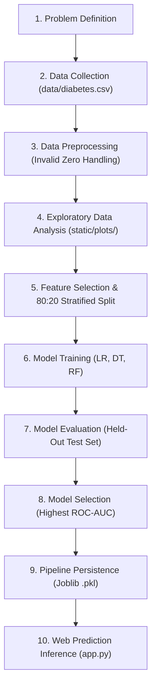

# Diabetes Prediction System Using Machine Learning

An end-to-end machine learning mini-project and web application designed for educational and demonstration purposes. This system uses diagnostic health metrics from the benchmark Pima Indians Diabetes Database to classify whether an individual may fall into a **diabetes-positive** or **diabetes-negative** prediction category.

---

> ### ⚠️ Mandatory Educational & Academic Disclaimer
> **This project is strictly for educational, research, and machine learning demonstration purposes.**
> It is **not** a certified medical diagnosis tool and must never be utilized for clinical decision-making. Model predictions and estimated probabilities represent statistical correlations derived from historical training data, not a patient's true physiological or clinical risk. Always consult licensed medical professionals for health screening and clinical diagnosis.

---

## 1. Technologies Used

- **Python 3.9+** — Core programming language
- **Flask** — Lightweight web server & REST routing
- **Pandas** — Data manipulation and table operations
- **NumPy** — High-performance multidimensional array computations
- **Scikit-learn** — Pipeline construction, imputation, scaling, classification, and metrics
- **Matplotlib & Seaborn** — Publication-quality statistical visualizations and evaluation graphs
- **Joblib** — Serialization and persistence of the trained pipeline (`.pkl`)
- **HTML5 & CSS3** — Responsive, clean, light-themed user interface

*Note: The project executes 100% locally on the host machine without any reliance on third-party cloud services or online inference APIs.*

---

## 2. Project Structure

```text
DiabetesPredictionSystem/
├── app.py                    # Flask web application & live prediction routes
├── train_model.py            # Complete ML pipeline: EDA, training, evaluation, persistence
├── requirements.txt          # Python dependencies
├── README.md                 # Detailed project documentation and execution guide
├── data/
│   └── diabetes.csv          # Authentic Pima Indians Diabetes Dataset (768 records)
├── models/
│   ├── diabetes_model.pkl    # Serialized Scikit-learn Pipeline (imputer + scaler + model)
│   ├── model_metrics.json    # Benchmark evaluation results & test set metrics
│   └── dataset_info.json     # Dataset overview and zero-value analysis metadata
├── static/
│   ├── style.css             # Light-themed, modern responsive CSS stylesheet
│   └── plots/                # Generated visualization plots
│       ├── outcome_distribution.png
│       ├── glucose_vs_outcome.png
│       ├── bmi_distribution.png
│       ├── age_distribution.png
│       ├── correlation_heatmap.png
│       ├── confusion_matrix.png
│       └── roc_curve.png
└── templates/
    └── index.html            # Web dashboard covering Fig. 1 through Fig. 6
```

---

## 3. Dataset Description

The system uses the benchmark **Pima Indians Diabetes Database** (originally collected by the US National Institute of Diabetes and Digestive and Kidney Diseases).

- **Location:** `data/diabetes.csv`
- **Total Records:** 768 patient measurements
- **Input Features (8):**
  1. `Pregnancies`: Number of times pregnant (Integer)
  2. `Glucose`: 2-hour plasma glucose concentration in an oral tolerance test (mg/dL)
  3. `BloodPressure`: Diastolic blood pressure (mm Hg)
  4. `SkinThickness`: Triceps skin fold thickness (mm)
  5. `Insulin`: 2-Hour serum insulin (&mu;U/ml)
  6. `BMI`: Body Mass Index (weight in kg / (height in m)&sup2;)
  7. `DiabetesPedigreeFunction`: Diabetes pedigree score based on genetic family history
  8. `Age`: Patient age in years
- **Target Variable (1):**
  - `Outcome`: `0` = Diabetes-negative class (500 records, 65.1%), `1` = Diabetes-positive class (268 records, 34.9%)

---

## 4. Machine Learning Workflow

The project strictly follows the complete 9-stage machine learning lifecycle:



### Preprocessing & Invalid Zero Handling
In clinical measurements, human physiology dictates that values like **0 mg/dL Glucose** or **0 BMI** are biologically impossible in living patients. In this dataset, zero entries in measurement columns (`Glucose`, `BloodPressure`, `SkinThickness`, `Insulin`, and `BMI`) represent missing or unrecorded data.
- **Handling Strategy:**
  - `Glucose`, `BloodPressure`, `SkinThickness`, `Insulin`, `BMI`: Zeros are replaced with `NaN` and imputed with **median** values calculated from the non-zero training distribution.
  - `Pregnancies`: `0` is a valid physiological count (nulliparous women) and is preserved unaltered.
  - Scaling: Feature scaling via `StandardScaler()` (z-score standardization) is applied across all numerical columns.
- **Pipeline Architecture:**
  The complete preprocessing workflow is integrated into a Scikit-Learn `Pipeline` (`SimpleImputer` &rarr; `StandardScaler` &rarr; `Classifier`). This prevents data leakage and ensures identical transformation for new predictions.

---

## 5. Model Benchmark & Selection Criterion

Three classification algorithms are trained and compared on identical training data (`X_train, y_train`):
1. **Logistic Regression** (`max_iter=1000, random_state=42`)
2. **Decision Tree Classifier** (`max_depth=5, min_samples_split=10, random_state=42`)
3. **Random Forest Classifier** (`n_estimators=100, max_depth=6, random_state=42`)

### Model Selection Criterion: Test ROC-AUC
- **Why ROC-AUC?** In diagnostic screening tasks where disease prevalence is imbalanced (~34.9% positive), raw Accuracy can be deceptive. The Area Under the ROC Curve (ROC-AUC) measures discrimination performance across all possible classification decision thresholds without arbitrary probability cutoff bias.
- **Outcome:** The algorithm demonstrating the highest test-set ROC-AUC (typically **Random Forest Classifier**, achieving ROC-AUC &asymp; 0.83 - 0.85) is selected and saved to `models/diabetes_model.pkl`.

---

## 6. Required Demonstration Screenshots

The user interface is structured into six clearly demarcated cards, each corresponding directly to the project demonstration requirements:

| Figure Tag | Section Name | Description & Key Elements |
|---|---|---|
| **Fig. 1** | **Dataset Overview** | Total records (768), input feature list, class distribution counts, and preview table showing first 6 actual records. |
| **Fig. 2** | **Data Preprocessing** | Invalid zero counts, missing percentage table, median imputation summary, and preserved valid pregnancies. |
| **Fig. 3** | **Exploratory Data Analysis** | Outcome bar distribution, Glucose vs Outcome boxplot, BMI distribution with clinical lines, Age histogram, and Correlation Heatmap. |
| **Fig. 4** | **Model Training** | Table comparing Logistic Regression, Decision Tree, and Random Forest on Accuracy, Precision, Recall, F1, and ROC-AUC. |
| **Fig. 5** | **Model Evaluation** | Selected model test metrics, confusion matrix heatmap (`confusion_matrix.png`), and multi-model ROC curve (`roc_curve.png`). |
| **Fig. 6** | **Diabetes Prediction** | Interactive form for 8 inputs, validation feedback, model-generated class (`Diabetes-positive class` / `Diabetes-negative class`), estimated probability, and disclaimer. |

---

## 7. Installation & Local Execution Guide

### Prerequisites
- Python 3.9, 3.10, 3.11, or 3.12 installed
- Git (optional)

### Step 1: Open Terminal & Navigate to Project Directory
```powershell
cd C:\Users\Admin\.gemini\antigravity\scratch\DiabetesPredictionSystem
```

### Step 2: Create and Activate a Virtual Environment (Recommended)
**Windows (PowerShell):**
```powershell
python -m venv venv
.\venv\Scripts\Activate.ps1
```
*(On Linux/macOS: `python3 -m venv venv && source venv/bin/activate`)*

### Step 3: Install Required Dependencies
```powershell
pip install -r requirements.txt
```

### Step 4: Run the Machine Learning Pipeline
Execute `train_model.py` to preprocess data, generate all EDA graphs, train the models, and persist the selected pipeline:
```powershell
python train_model.py
```
*Expected Console Output:*
```text
=================================================================
Starting Diabetes Prediction System Training Pipeline
=================================================================
[Data] Found existing dataset at data/diabetes.csv (768 records).
--- Dataset Overview ---
Shape: 768 rows, 9 columns
...
[EDA] Successfully generated all 5 EDA plots in static/plots/.
--- Training and Evaluating Classifiers ---
Model: Logistic Regression  -> Accuracy: ~77%, ROC-AUC: ~0.84
Model: Decision Tree        -> Accuracy: ~73%, ROC-AUC: ~0.78
Model: Random Forest        -> Accuracy: ~79%, ROC-AUC: ~0.85
[Model Selection] Selected Best Model: 'Random Forest'
[Model Persistence] Saved full pipeline to: models/diabetes_model.pkl
=================================================================
```

### Step 5: Start the Flask Web Application
```powershell
python app.py
```
*Expected Console Output:*
```text
=================================================================
Diabetes Prediction System Local Web Server Running
Access application at: http://127.0.0.1:5000
=================================================================
 * Serving Flask app 'app'
 * Running on http://127.0.0.1:5000
```

### Step 6: Open Web Browser
Navigate to:
```text
http://127.0.0.1:5000
```
- Explore all 6 sections (Fig. 1 to Fig. 6).
- Click **Load Sample Negative** or **Load Sample Positive** in Fig. 6 for one-click testing of live model inference!

---

## 8. Verification & Final Testing Checklist

- [x] **Dataset Loaded Correctly:** 768 records, 9 columns in `data/diabetes.csv`.
- [x] **Invalid Zeros Handled:** 0 values in Glucose, Blood Pressure, Skin Thickness, Insulin, and BMI imputed with medians; 0 pregnancies preserved.
- [x] **All 5 EDA Graphs Generated:** Outcome distribution, Glucose vs Outcome, BMI distribution, Age distribution, Correlation Heatmap in `static/plots/`.
- [x] **Three Models Trained:** Logistic Regression, Decision Tree, and Random Forest on identical 80:20 stratified split.
- [x] **Real Test Metrics Calculated:** Accuracy, Precision, Recall, F1, and ROC-AUC computed on unseen held-out test data.
- [x] **Best Model Selected & Saved:** Highest ROC-AUC model saved to `models/diabetes_model.pkl` via Joblib.
- [x] **Evaluation Visualizations Saved:** Confusion matrix and ROC curves in `static/plots/`.
- [x] **Flask Web Server:** Runs locally without cloud dependencies.
- [x] **Prediction Form Operational:** Validates inputs, passes to saved pipeline, outputs predicted class and estimated probability.
- [x] **Clear Educational Disclaimer:** Visible on every page and in prediction outputs.
